<div align="center">
  
  <p>Universidad Peruana de Ciencias Aplicadas</p>
  <p>Carrera de Ingeniería de Software</p>
  <p><strong>1ASI0572</strong></p>
  <p><strong>Desarrollo de Soluciones IOT</strong></p>
  <p>NRC</p>
  <p><strong>16518</strong></p>
  <h2>Informe de Laboratorio 2</h2>
  <p>Docente</p>
  <p><strong>Sanchez Portugal, Jimmy Enrique</strong></p>
  <p>Equipo</p>
  <p><strong>PrimeFuel</strong></p>
  <p>Proyecto</p>
  <p><strong>FullTank</strong></p>
</div>
<h2 align="center">Integrantes</h2>
<div align="center">
  <table>
    <tr>
      <th><strong>Código</strong></th>
      <th><strong>Apellidos y Nombres</strong></th>
    </tr>
    <tr>
      <td>u202317269</td>
      <td>Bonifacio Jaramillo Samuel Jesus</td>
    </tr>
    <tr>
      <td>u201822823</td>
      <td>Castro Pariona Jefferson Ernesto</td>
    </tr>
    <tr>
      <td>u20221a118</td>
      <td>Katherine Maryory Mejia Aliaga</td>
    </tr>
    <tr>
      <td>u202320684</td>
      <td>Ponce Perales Alberto Alejandro</td>
    </tr>
    <tr>
      <td>u202321843</td>
      <td>Delgado Carrasco Schneider Carlos Alberto</td>
    </tr>
    <tr>
      <td>u202312700</td>
      <td>Lopez Goitia Carlos Alberto</td>
    </tr>
    <tr>
      <td>u202223286</td>
      <td>Rodriguez Parco Joseph Pablo</td>
    </tr>
      <tr>
      <td>u202116246</td>
      <td>Guerrero Vasquez Jhon Danny</td>
    </tr>
  </table>
</div>
<div align="center">
  <p><strong>Período 202620</strong></p>
  <p><strong>Setiembre 2026</strong></p>
</div>

---

# FullTank — Lab 2: Conectividad IoT con la nube

**Curso:** 1ASI0572 Desarrollo de Soluciones IoT (UPC)
**Proyecto:** Monitoreo de tanques de combustible
**Grupo:** G02 · **Canal ThingSpeak:** `TANQUE-G02` (Channel ID `3546655`)

---

## ¿Qué haremos?

Conectaremos un **ESP32** a una red Wi-Fi para que envíe cada 20 segundos el nivel de un tanque a la nube (**ThingSpeak**). Allí los datos se verán como gráficas en tiempo real. Al final, exportaremos esos datos para analizarlos y documentaremos todo con evidencias.

```
 Sensor / simulación  →  ESP32  →  Wi-Fi  →  ThingSpeak  →  Gráficas + CSV
```

## Tecnologías

<table>
  <thead>
    <tr>
      <th>Tecnología</th>
      <th>Para qué la usamos</th>
    </tr>
  </thead>
  <tbody>
    <tr>
      <td><strong>ESP32 DevKit V1</strong></td>
      <td>Microcontrolador con Wi-Fi que lee y envía los datos</td>
    </tr>
    <tr>
      <td><strong>Sensor HC-SR04</strong></td>
      <td>Mide la distancia al líquido (ultrasonido) para calcular el nivel</td>
    </tr>
    <tr>
      <td><strong>Arduino IDE 2.x</strong> (C++)</td>
      <td>Programar y cargar el código al ESP32</td>
    </tr>
    <tr>
      <td><strong>Librería ThingSpeak</strong></td>
      <td>Enviar los datos a la nube por HTTP</td>
    </tr>
    <tr>
      <td><strong>ThingSpeak</strong> (MathWorks)</td>
      <td>Guardar la telemetría y mostrarla en gráficas</td>
    </tr>
    <tr>
      <td><strong>Numbers / Excel</strong></td>
      <td>Analizar el CSV exportado</td>
    </tr>
    <tr>
      <td><strong>GitHub</strong></td>
      <td>Versionar el código y guardar las evidencias</td>
    </tr>
  </tbody>
</table>


*Código del ESP32 en Arduino IDE, con el monitor serie mostrando las lecturas.*

## Rutas de trabajo

<table>
  <thead>
    <tr>
      <th>Ruta</th>
      <th>Qué se hace</th>
      <th>Requisito</th>
    </tr>
  </thead>
  <tbody>
    <tr>
      <td><strong>1. Simulación</strong> (obligatoria)</td>
      <td>El ESP32 simula un tanque que se vacía solo. Se controla desde el monitor serie (<code>N=</code> nivel, <code>C=</code> consumo) y el botón BOOT lo rellena.</td>
      <td>Solo el ESP32</td>
    </tr>
    <tr>
      <td><strong>2. Sensor real</strong></td>
      <td>El HC-SR04 mide la distancia real y se calcula el % de nivel.</td>
      <td>ESP32 + HC-SR04</td>
    </tr>
    <tr>
      <td><strong>3. Sensor con alarma</strong></td>
      <td>Igual que la Ruta 2, pero filtra lecturas (mediana), enciende un LED y envía un mensaje de estado cuando el nivel baja de 20 %.</td>
      <td>ESP32 + HC-SR04 + LED</td>
    </tr>
  </tbody>
</table>


*Prototipo para las Rutas 2 y 3: ESP32, sensor ultrasónico y divisor de voltaje en la protoboard.*

## Telemetría y gráficas

El ESP32 envía 4 datos en cada lectura. ThingSpeak dibuja una gráfica por cada uno:

<table>
  <thead>
    <tr>
      <th>Campo</th>
      <th>Dato</th>
      <th>Qué muestra la gráfica</th>
    </tr>
  </thead>
  <tbody>
    <tr>
      <td>Field 1</td>
      <td>Distancia (cm)</td>
      <td>Distancia del sensor al líquido</td>
    </tr>
    <tr>
      <td>Field 2</td>
      <td>Nivel (%)</td>
      <td>Cuánto combustible queda en el tanque</td>
    </tr>
    <tr>
      <td>Field 3</td>
      <td>RSSI (dBm)</td>
      <td>Calidad de la señal Wi-Fi</td>
    </tr>
    <tr>
      <td>Field 4</td>
      <td>Alarma (0/1)</td>
      <td>Se activa cuando el nivel es menor a 20 %</td>
    </tr>
  </tbody>
</table>


*Lecturas del sensor en el monitor serie: se envían las válidas y se descartan las del punto ciego.*


*Canal `TANQUE-G02` creado en ThingSpeak, donde llega la telemetría.*

Las gráficas se ven en **ThingSpeak → Private View** (o en la vista pública del canal) y se actualizan solas cada 20 s. Luego exportamos los datos a **CSV** para calcular el mínimo, el máximo, el promedio y el % de envíos exitosos.

## Estructura del repositorio

```
lab2/
├── img/                    # imágenes del README
├── sketch/                 # código del ESP32 (secrets.h no se sube)
├── .gitignore
└── evidencias/sesionXX/    # capturas E1–E9, CSV, video e informe
```

## Partes del laboratorio

### Crear el canal en ThingSpeak

Definimos el tópico MQTT `upc1asi0572/tanque-g02` en el broker público HiveMQ, al que se conecta nuestro dashboard web para ver las lecturas en tiempo real.

El dashboard (canal **TANQUE-G00**) muestra:
- Configuración del canal (broker WebSocket seguro y tópico base).
- Channel Stats: primera entrada, última entrada, entradas totales, mensajes descartados.
- Mensaje de estado (equivale al status de ThingSpeak, enviado por el ESP32 en cada lectura).
- Última lectura: Distancia (cm), Nivel (%), RSSI (dBm), Alarma.
- Gráficos por campo: Distancia (cm), Nivel (%), RSSI (dBm), Alarma (0/1).

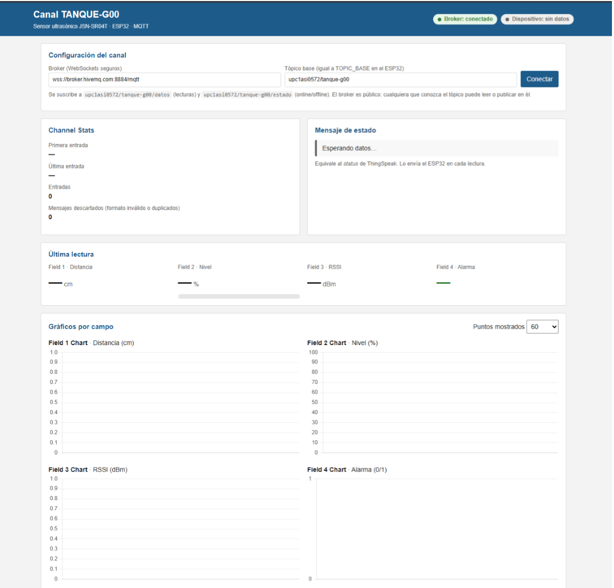

*Dashboard web conectado al broker MQTT, esperando la primera lectura del ESP32.*

### Preparar Arduino IDE y las credenciales

Configuramos Arduino IDE con la placa **ESP32 Dev Module** y el puerto `/dev/cu.usbserial-0001`, e instalamos las librerías **ThingSpeak** y **PubSubClient**. Las credenciales del Wi-Fi y la Write API Key se guardan en `secrets.h`, que está excluido del repositorio mediante `.gitignore`.

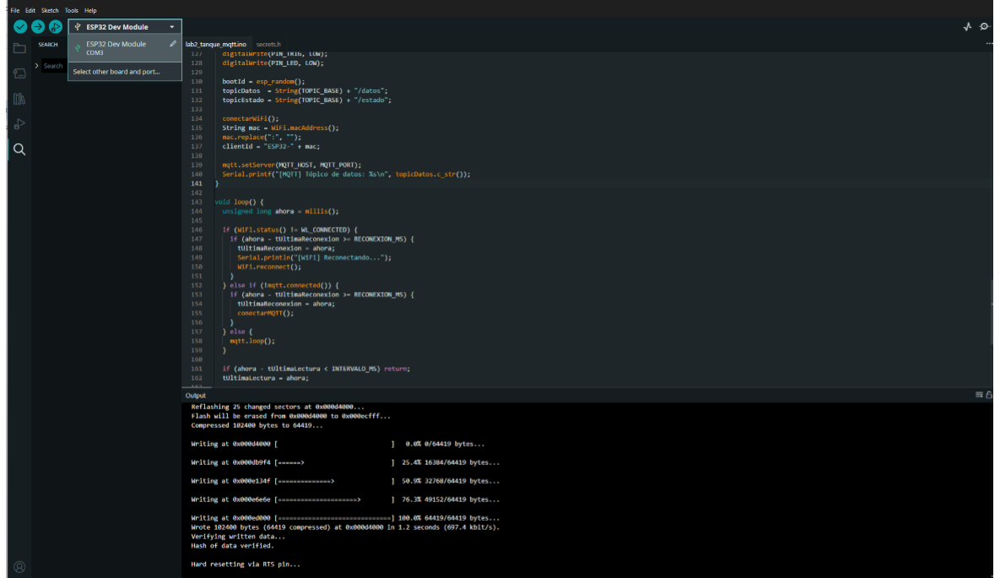

*Arduino IDE compilando y subiendo el sketch al ESP32 por el puerto COM3.*

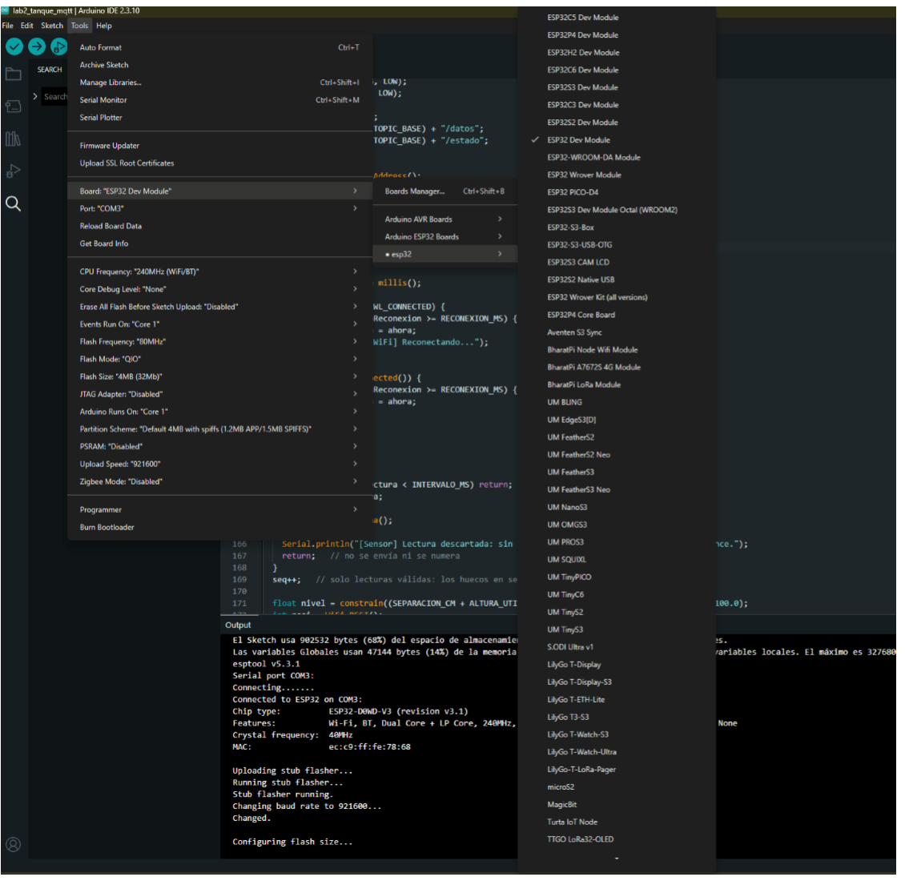

*Selección de la placa ESP32 Dev Module y el puerto en el menú Tools de Arduino IDE.*

### Sketch base y Ruta 1, con envío a la nube

El sketch base conecta el ESP32 al hotspot y muestra en el monitor serie la IP, el SSID y la MAC. Luego inicia el cliente de ThingSpeak y se conecta al broker MQTT. Cada 5 s publica la lectura por MQTT y cada 20 s la escribe en ThingSpeak, respetando el mínimo de 15 s de la cuenta gratuita.

Implementamos la Ruta 3 con el sensor impermeable **JSN-SR04T** sobre una maqueta con agua. El ESP32 toma cinco mediciones y usa la mediana para descartar ecos falsos, convierte la distancia en porcentaje de nivel y activa la alarma, el LED integrado y el mensaje **"ALERTA: nivel bajo"** cuando el nivel baja de 20 %. El sensor se montó a `[S]` cm del nivel máximo para quedar fuera de su zona ciega.

Ejemplo de salida del monitor serie:

```
[Sensor] Lectura descartada: Objeto en punto ciego (< 25 cm) o fuera de alcance.
[Sensor] Distancia válida: 27.5 cm
[MQTT] Publicado en 'mi_proyecto/ultrasonido': 27.5
[Sensor] Lectura descartada: Objeto en punto ciego (< 25 cm) o fuera de alcance.
[Sensor] Distancia válida: 28.0 cm
[MQTT] Publicado en 'mi_proyecto/ultrasonido': 28.0
```

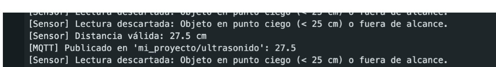

*Monitor serie del ESP32: lecturas descartadas por zona ciega y lecturas válidas publicadas por MQTT.*

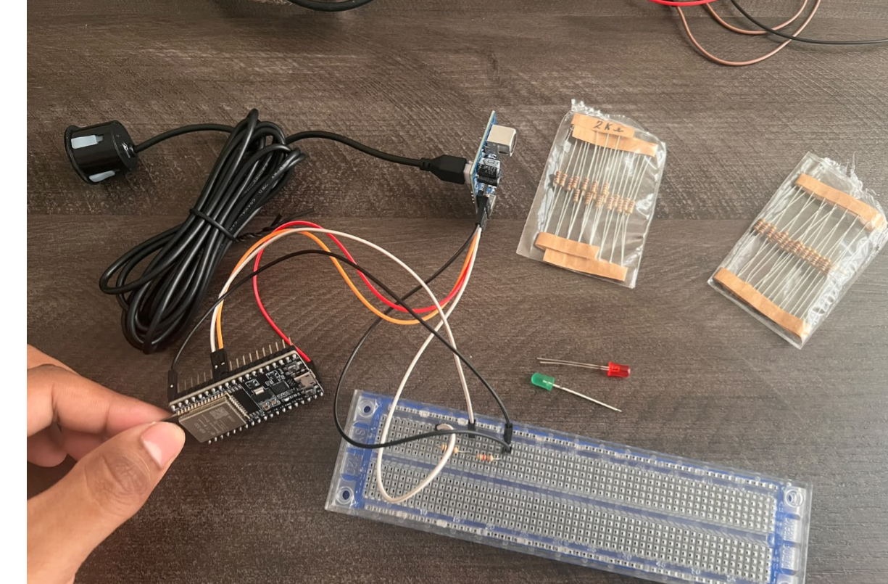

*Componentes del armado: ESP32, sensor ultrasónico, resistencias de 2k y LEDs (verde y rojo) para la alarma.*

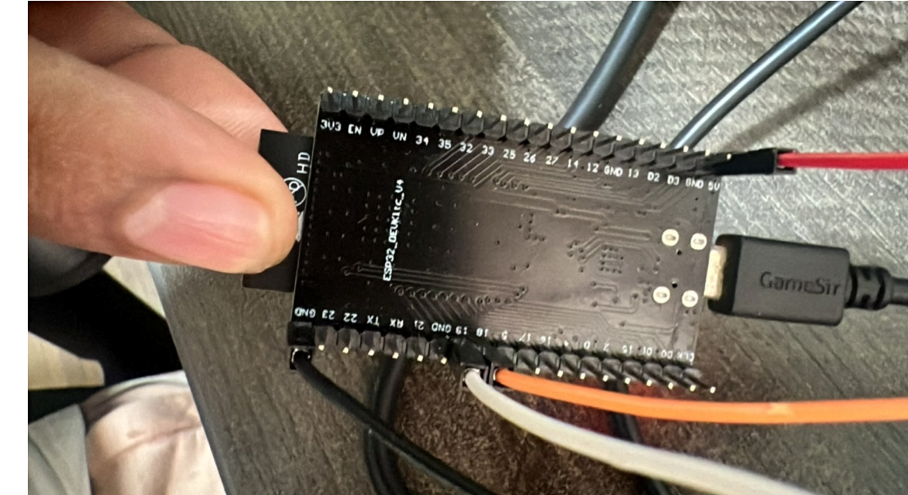

*Detalle de las conexiones del ESP32 (pines de datos, alimentación y USB).*

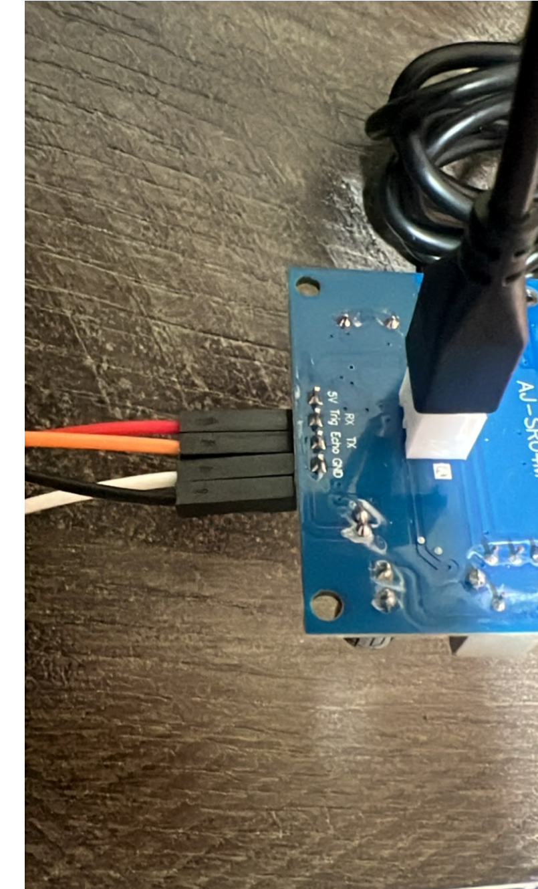

*Sensor ultrasónico AJ-SR04M, con sus pines 5V, Trig, Echo y GND cableados a la protoboard.*

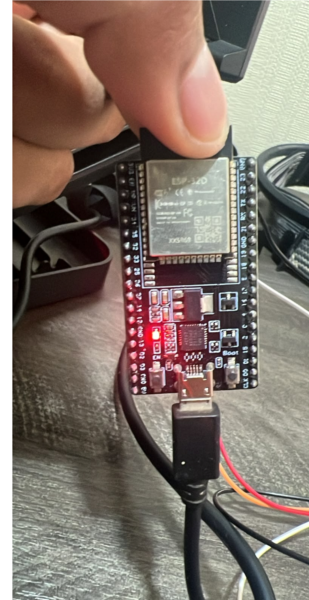

*ESP32 alimentado por USB, con el LED integrado encendido durante la ejecución del sketch.*

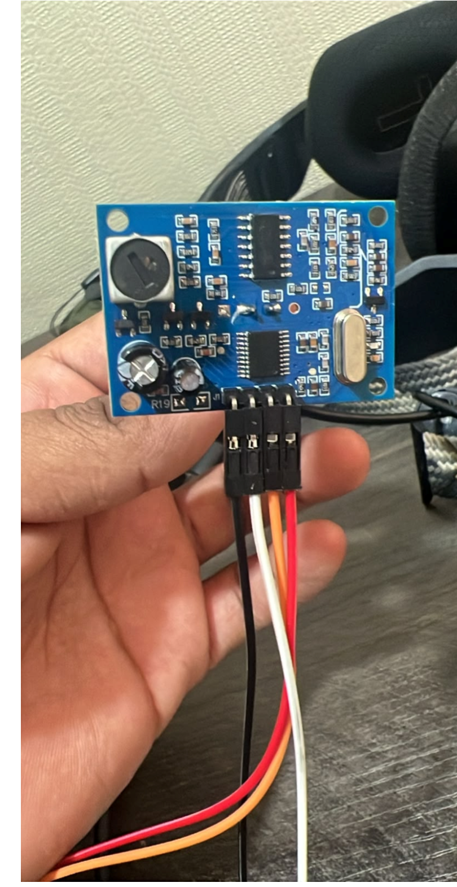

*Módulo de control del sensor ultrasónico con sus cables de señal (trigger, echo, alimentación y tierra).*

### Escenarios de prueba, o Rutas 2 y 3

Subimos el programa y verificamos en el monitor serie que ThingSpeak respondió con código 200 en cada envío y que las publicaciones MQTT salían correctamente.

Como escenario de prueba partimos con la maqueta llena, retiramos agua hasta que el nivel bajó de 20 % (se activaron la alarma, el LED y el mensaje de estado) y luego volvimos a llenarla. El cambio se vio en ThingSpeak y, al instante, en el dashboard.

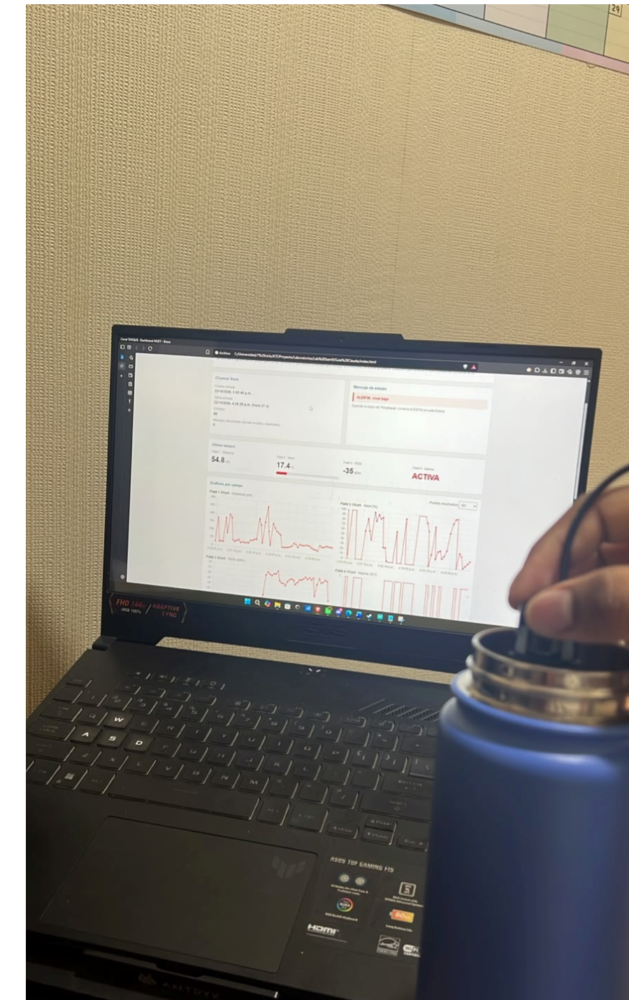

*Escenario de prueba: se retira agua de la botella mientras el dashboard muestra la alarma activa en tiempo real.*

### Capturar evidencias y analizar el CSV

Exportamos el CSV desde el dashboard y calculamos los valores de la tabla. Se recibieron 70 lecturas de 70 esperadas (100 %), calculado con el número de secuencia; esto mide la transmisión de los datos, no la exactitud del sensor. El nivel varió entre 0 % y 100 % (promedio 44,7 %) al subir y bajar el agua de la botella / mover el sensor, y la alarma se activó en 29 de 70 lecturas, siempre con el nivel bajo 20 %. El RSSI se mantuvo entre −59 y −12 dBm (promedio −33,7 dBm). Las distancias altas (hasta 269 cm) corresponden a momentos en que el sensor se retiró de la botella.

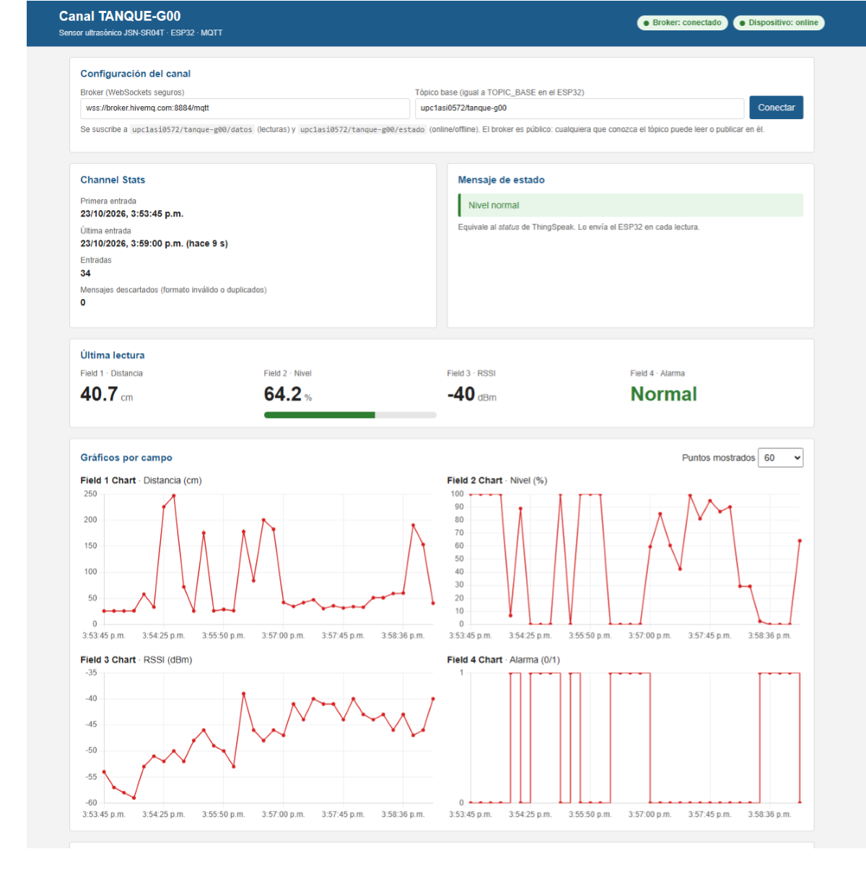

*Dashboard con datos reales en curso: nivel 64.2 %, RSSI −40 dBm, y las cuatro gráficas actualizándose cada 5 s.*

| Variable | Mínimo | Máximo | Promedio |
|---|---|---|---|
| Distancia (cm) | 25,3 | 269,3 | 72,2 |
| Nivel (%) | 0,0 | 100,0 | 44,7 |
| RSSI (dBm) | −59 | −12 | −33,7 |

**Período:** 23/10/2026, 3:53:45 p.m. → 23/10/2026, 4:25:55 p.m. (32.2 min)
**Lecturas con alarma:** 29 de 70
**Envíos recibidos / esperados:** 70 / 70 (100.0 %)

> Los envíos esperados salen del número de lectura (`seq`) que manda el ESP32: si llegan la 1, 2 y 4, se esperaban 4 y llegaron 3. Si el ESP32 se reinicia, la secuencia vuelve a 1 y se cuenta como un tramo nuevo.

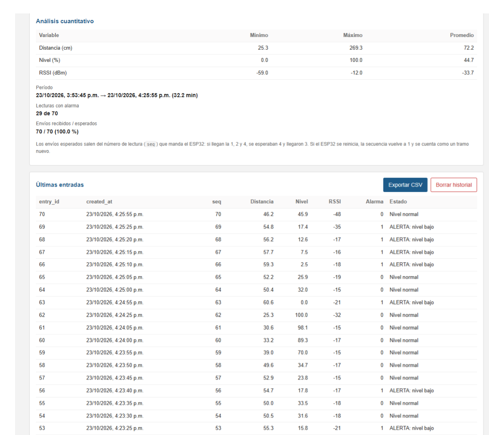

*Panel de análisis cuantitativo del dashboard, con el período, las lecturas con alarma y el detalle de las últimas entradas.*

El CSV exportado (`tanque-g00_datos.csv`) contiene las columnas: `created_at, entry_id, field1, field2, field3, field4, status, seq, boot`, correspondientes a Distancia, Nivel, RSSI y Alarma respectivamente.

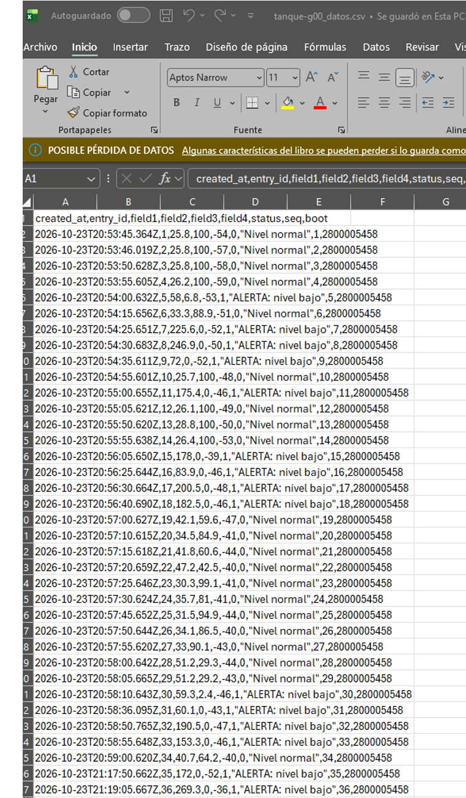

*CSV `tanque-g00_datos.csv` exportado desde el dashboard y abierto en Excel para el análisis.*

## Conclusiones

- El ESP32 se conectó al hotspot y publicó sus lecturas por MQTT en el broker HiveMQ, y al dashboard llegaron las 70 lecturas esperadas, es decir el 100 % según el número de secuencia. Este porcentaje mide la transmisión de los datos y no la exactitud del sensor.
- El ESP32 toma cinco mediciones del sensor AJ-SR04M y usa la mediana para descartar ecos falsos. Con esa distancia calcula el nivel en porcentaje y, cuando baja de 20 %, activa la alarma, el LED y el mensaje de estado. En el CSV la alarma coincidió con los niveles bajo 20 %, y se activó en 29 de las 70 lecturas.
- El sensor no mide por debajo de unos 25 cm por su zona ciega, así que debe montarse por encima del nivel máximo de agua. Las distancias muy altas, de hasta 269 cm, corresponden a momentos en que el sensor no apuntaba a la superficie de la botella. Para un uso real harían falta un montaje fijo y un tanque de tamaño real.
- En lugar de ThingSpeak usamos MQTT con un dashboard propio. Con eso ganamos un intervalo de envío de 5 s, el estado online u offline del dispositivo y control total sobre los gráficos y el análisis. Perdimos la confirmación del servidor, que en ThingSpeak es el código 200, porque la función publish solo indica que el mensaje salió del ESP32, y el historial queda guardado solo en el navegador y no en la nube.
- El broker es público y no pide credenciales, por lo que cualquiera que conozca el tópico puede leer los datos o publicar datos falsos, y además el ESP32 publica por el puerto 1883 sin cifrado. En un sistema real se usaría un broker privado con TLS, un usuario por dispositivo y permisos por tópico, y los datos se guardarían en una base de datos en la nube.

## Integrantes

- Samuel Bonifacio
- Jhon Guerrero
- Alberto Ponce
- Jefferson Castro
- Joseph Rodríguez
- Katherine Mejia
- Schneider Delgado
- Carlos Lopez

> **Seguridad:** las credenciales (Wi-Fi y API Key) van en `secrets.h`, que está en `.gitignore`. En la maqueta se usa agua, porque el HC-SR04 no está certificado para atmósferas inflamables.
