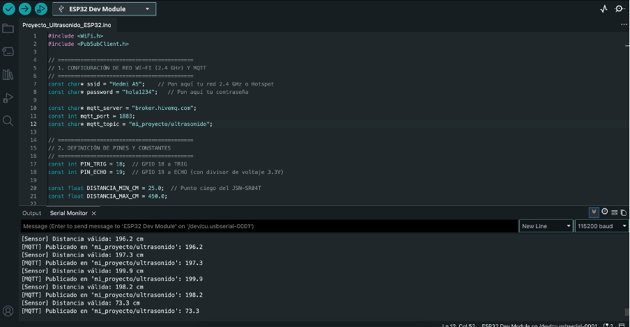
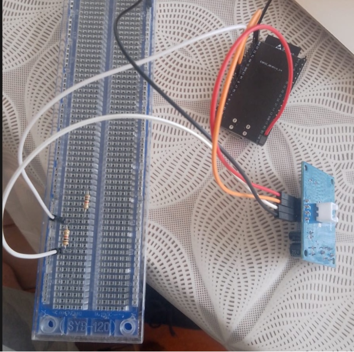
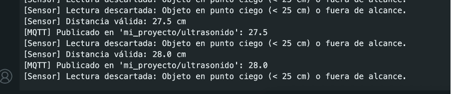
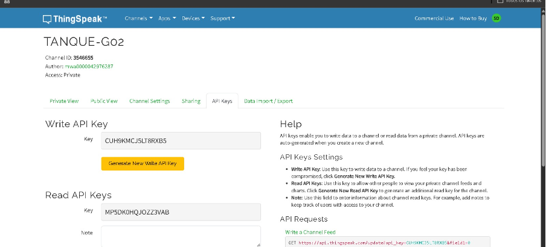

# FullTank — Lab 2: Conectividad IoT con la nube

**Curso:** 1ASI0572 Desarrollo de Soluciones IoT (UPC)
**Proyecto:** Monitoreo de tanques de combustible
**Grupo:** G02 · **Canal ThingSpeak:** `TANQUE-G02` (Channel ID `3546655`)

---

## ¿Qué haremos?

Conectaremos un **ESP32** a una red Wi-Fi para que envíe cada 20 segundos el nivel de un tanque a la nube (**ThingSpeak**). Allí los datos se verán como gráficas en tiempo real. Al final, exportaremos esos datos para analizarlos y documentaremos todo con evidencias.

```
 Sensor / simulación  →  ESP32  →  Wi-Fi  →  ThingSpeak  →  Gráficas + CSV
```

## Tecnologías

<table>
  <thead>
    <tr>
      <th>Tecnología</th>
      <th>Para qué la usamos</th>
    </tr>
  </thead>
  <tbody>
    <tr>
      <td><strong>ESP32 DevKit V1</strong></td>
      <td>Microcontrolador con Wi-Fi que lee y envía los datos</td>
    </tr>
    <tr>
      <td><strong>Sensor HC-SR04</strong></td>
      <td>Mide la distancia al líquido (ultrasonido) para calcular el nivel</td>
    </tr>
    <tr>
      <td><strong>Arduino IDE 2.x</strong> (C++)</td>
      <td>Programar y cargar el código al ESP32</td>
    </tr>
    <tr>
      <td><strong>Librería ThingSpeak</strong></td>
      <td>Enviar los datos a la nube por HTTP</td>
    </tr>
    <tr>
      <td><strong>ThingSpeak</strong> (MathWorks)</td>
      <td>Guardar la telemetría y mostrarla en gráficas</td>
    </tr>
    <tr>
      <td><strong>Numbers / Excel</strong></td>
      <td>Analizar el CSV exportado</td>
    </tr>
    <tr>
      <td><strong>GitHub</strong></td>
      <td>Versionar el código y guardar las evidencias</td>
    </tr>
  </tbody>
</table>



*Código del ESP32 en Arduino IDE, con el monitor serie mostrando las lecturas.*

## Rutas de trabajo

<table>
  <thead>
    <tr>
      <th>Ruta</th>
      <th>Qué se hace</th>
      <th>Requisito</th>
    </tr>
  </thead>
  <tbody>
    <tr>
      <td><strong>1. Simulación</strong> (obligatoria)</td>
      <td>El ESP32 simula un tanque que se vacía solo. Se controla desde el monitor serie (<code>N=</code> nivel, <code>C=</code> consumo) y el botón BOOT lo rellena.</td>
      <td>Solo el ESP32</td>
    </tr>
    <tr>
      <td><strong>2. Sensor real</strong></td>
      <td>El HC-SR04 mide la distancia real y se calcula el % de nivel.</td>
      <td>ESP32 + HC-SR04</td>
    </tr>
    <tr>
      <td><strong>3. Sensor con alarma</strong></td>
      <td>Igual que la Ruta 2, pero filtra lecturas (mediana), enciende un LED y envía un mensaje de estado cuando el nivel baja de 20 %.</td>
      <td>ESP32 + HC-SR04 + LED</td>
    </tr>
  </tbody>
</table>



*Prototipo para las Rutas 2 y 3: ESP32, sensor ultrasónico y divisor de voltaje en la protoboard.*

## Telemetría y gráficas

El ESP32 envía 4 datos en cada lectura. ThingSpeak dibuja una gráfica por cada uno:

<table>
  <thead>
    <tr>
      <th>Campo</th>
      <th>Dato</th>
      <th>Qué muestra la gráfica</th>
    </tr>
  </thead>
  <tbody>
    <tr>
      <td>Field 1</td>
      <td>Distancia (cm)</td>
      <td>Distancia del sensor al líquido</td>
    </tr>
    <tr>
      <td>Field 2</td>
      <td>Nivel (%)</td>
      <td>Cuánto combustible queda en el tanque</td>
    </tr>
    <tr>
      <td>Field 3</td>
      <td>RSSI (dBm)</td>
      <td>Calidad de la señal Wi-Fi</td>
    </tr>
    <tr>
      <td>Field 4</td>
      <td>Alarma (0/1)</td>
      <td>Se activa cuando el nivel es menor a 20 %</td>
    </tr>
  </tbody>
</table>



*Lecturas del sensor en el monitor serie: se envían las válidas y se descartan las del punto ciego.*



*Canal `TANQUE-G02` creado en ThingSpeak, donde llega la telemetría.*

Las gráficas se ven en **ThingSpeak → Private View** (o en la vista pública del canal) y se actualizan solas cada 20 s. Luego exportamos los datos a **CSV** para calcular el mínimo, el máximo, el promedio y el % de envíos exitosos.

## Estructura del repositorio

```
lab2/
├── img/                    # imágenes del README
├── sketch/                 # código del ESP32 (secrets.h no se sube)
├── .gitignore
└── evidencias/sesionXX/    # capturas E1–E9, CSV, video e informe
```

## Integrantes

- Samuel Bonifacio
- Jhon Guerrero
- Alberto Ponce
- Jefferson Castro
- Joseph Rodríguez
- Katherine Mejia
- Schneider Delgado
- Carlos Lopez

> **Seguridad:** las credenciales (Wi-Fi y API Key) van en `secrets.h`, que está en `.gitignore`. En la maqueta se usa agua, porque el HC-SR04 no está certificado para atmósferas inflamables.
